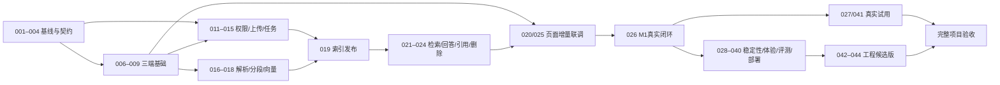

# KnowFlow V0.2 细分任务与验收卡

**日期：** 2026-10-29  
**编制：** A = Codex Coding Agent 1；B = Codex Coding Agent 2；M = Muse 主线 Agent；Q = Code Review Agent。  
**状态：** 本文件是待执行的计划；没有任务因文档生成而完成。44 项核心任务 + 12 项可选增强，共 56 项。  
**关联：** [项目计划](./KnowFlow_V0.2_项目计划书.md)、[协作手册](./KnowFlow_V0.2_Agent协作手册.md)、[机器可读任务数据](./KnowFlow_V0.2_任务数据.json)、[CSV](./KnowFlow_V0.2_任务表.csv)。

## 使用规则

- 新任务编号 KF2-* 与原设计包的 KF-* 分开；001 核对后建立映射，不覆盖旧编号。
- “依赖”是验收所需硬依赖，必须完成真实整合才能关闭；“可提前开发”只允许草稿/Mock，不解除依赖。
- 依赖完成包含适用的审阅与测试通过。Q 对每个A/B/M任务滚动审阅；044 是最终集成审阅，不替代日常审阅。
- 原设计包缺失、模型配置不可用、用户试用无人参与分别记录 WAITING_INPUT/BLOCKED，不冒充已验收。
- S/M 表示相对复杂度，不代表已承诺工时。建议把可实施任务约束在一个主要目标、一个小PR；发现跨多个独立目标或两个有效工作时段仍无法提交，就追加子任务，更新依赖后再派工。
- 范围是默认文件所有权。需要改其他Agent目录/公共契约时先登记协同子任务，由所有者提交；不得以完成验收为由直接跨目录抢改。
- 每张卡继承计划中的模型隐私、资源上限、租约、权限和引用规则。作者必须填写具体测试命令、环境、结果与SHA；此处列的是验证要求，不代表测试已运行。
- 自动测试聚焦权限、状态一致性、解析/检索、契约与完整流程；文案/目录等低风险修改按检查验收，不写仅复述实现的测试。
- S4默认未启用。V1完成后按实际需求选择，启用一项只要求其依赖闭包；不要求全部12项一起完成。新增跨所有权子任务也必须审阅后才能关闭父任务。

## 依赖主链

以上为阅读用摘要；每张卡和任务数据中的明确依赖为准。完整项目验收同时要求工程候选版通过与041真实试用完成。M1前M可按已冻结契约提前写页面；不要等B完成所有AI能力后才开始前端。

## 角色负载与阶段

| 阶段 | A | B | M | Q专属任务 | 合计 |
|---|---:|---:|---:|---:|---:|
| S0 契约与工程准备 | 3 | 3 | 4 | 0 | 10 |
| S1 首个真实闭环 | 8 | 5 | 3 | 0 | 16 |
| S2 稳定性、体验与价值验证 | 5 | 4 | 6 | 0 | 15 |
| S3 集成与交付审阅 | 0 | 0 | 2 | 1 | 3 |
| S4 V1.5 可选增强 | 3 | 6 | 3 | 0 | 12 |

任务数量不代表工作量相等。Q还需审阅全部主线任务；M负责UI、基础设施与E2E，接近阶段末时优先联调和修复，不同时启动增强页面。A兼任协调，但不因此接管B/M实现。

## 总览

| ID | 阶段 | 负责人 | 任务 | 硬依赖 | 默认启用 |
|---|---|---|---|---|---|
| [KF2-001](#kf2-001) | S0 | A | 核对原设计包与旧任务映射 | 无 | 是 |
| [KF2-002](#kf2-002) | S0 | M | 锁定首轮用户任务与验证脚本 | 无 | 是 |
| [KF2-003](#kf2-003) | S0 | B | 验证模型、隐私、依赖与资源基线 | 无 | 是 |
| [KF2-004](#kf2-004) | S0 | A | 冻结共享契约和状态所有权 | KF2-001, KF2-002, KF2-003 | 是 |
| [KF2-005](#kf2-005) | S0 | M | 建立仓库组织与协作基础 | 无 | 是 |
| [KF2-006](#kf2-006) | S0 | A | 交付 Java 最小服务骨架 | KF2-004, KF2-005 | 是 |
| [KF2-007](#kf2-007) | S0 | B | 交付 Python 最小服务骨架 | KF2-004, KF2-005 | 是 |
| [KF2-008](#kf2-008) | S0 | M | 交付前端骨架与契约 Mock | KF2-004, KF2-005 | 是 |
| [KF2-009](#kf2-009) | S0 | M | 打通 Compose 和首条 CI | KF2-006, KF2-007, KF2-008 | 是 |
| [KF2-010](#kf2-010) | S0 | B | 准备合法文档、种子问题和标注规范 | KF2-002, KF2-003 | 是 |
| [KF2-011](#kf2-011) | S1 | A | 建立首批数据库迁移与受限角色 | KF2-004, KF2-005 | 是 |
| [KF2-012](#kf2-012) | S1 | A | 实现基础认证与当前用户 | KF2-006, KF2-011 | 是 |
| [KF2-013](#kf2-013) | S1 | A | 实现个人知识库与所有者隔离 | KF2-012 | 是 |
| [KF2-014](#kf2-014) | S1 | A | 实现文件上传和文档状态 API | KF2-009, KF2-013 | 是 |
| [KF2-015](#kf2-015) | S1 | A | 实现任务调度、租约和结果验收入口 | KF2-007, KF2-014 | 是 |
| [KF2-016](#kf2-016) | S1 | B | 实现 TXT/MD/文本型 PDF 解析 | KF2-007, KF2-010 | 是 |
| [KF2-017](#kf2-017) | S1 | B | 实现可复现分段与证据定位 | KF2-016 | 是 |
| [KF2-018](#kf2-018) | S1 | B | 实现 Embedding 和版本隔离的索引写入 | KF2-003, KF2-011, KF2-017 | 是 |
| [KF2-019](#kf2-019) | S1 | A | 接通索引验收与首版发布 | KF2-015, KF2-018 | 是 |
| [KF2-020](#kf2-020) | S1 | M | 实现登录、知识库、上传与状态页面 | KF2-008, KF2-013, KF2-014, KF2-019 | 是 |
| [KF2-021](#kf2-021) | S1 | B | 实现权限受控的向量检索基线 | KF2-018, KF2-019 | 是 |
| [KF2-022](#kf2-022) | S1 | B | 实现单轮生成、拒答与可核验证据 | KF2-003, KF2-021 | 是 |
| [KF2-023](#kf2-023) | S1 | A | 实现统一问答入口和结果权限复核 | KF2-013, KF2-022 | 是 |
| [KF2-024](#kf2-024) | S1 | A | 实现引用原文访问与删除即时失效 | KF2-019, KF2-023 | 是 |
| [KF2-025](#kf2-025) | S1 | M | 实现真实问答与引用核验页面 | KF2-020, KF2-023, KF2-024 | 是 |
| [KF2-026](#kf2-026) | S1 | M | 验收 M1 首个真实纵向闭环 | KF2-009, KF2-025 | 是 |
| [KF2-027](#kf2-027) | S2 | M | 启动真实用户试用和任务对照 | KF2-002, KF2-026 | 是 |
| [KF2-028](#kf2-028) | S2 | A | 实现更新、重建和活动索引原子切换 | KF2-026 | 是 |
| [KF2-029](#kf2-029) | S2 | A | 实现历史来源与失效/保留策略 | KF2-024, KF2-028 | 是 |
| [KF2-030](#kf2-030) | S2 | B | 实现 AI 流式生成与取消传播 | KF2-004, KF2-022 | 是 |
| [KF2-031](#kf2-031) | S2 | A | 实现 SSE 网关与输出前权限复核 | KF2-023, KF2-030 | 是 |
| [KF2-032](#kf2-032) | S2 | M | 实现流式页面与中断恢复体验 | KF2-025, KF2-031 | 是 |
| [KF2-033](#kf2-033) | S2 | A | 实现问答记录与列表 API | KF2-023, KF2-029, KF2-031 | 是 |
| [KF2-034](#kf2-034) | S2 | M | 实现历史、PDF页码预览与完整错误体验 | KF2-029, KF2-032, KF2-033 | 是 |
| [KF2-035](#kf2-035) | S2 | B | 加固解析边界与资源限制 | KF2-016, KF2-026 | 是 |
| [KF2-036](#kf2-036) | S2 | A | 验证索引一致性与故障恢复 | KF2-028, KF2-029 | 是 |
| [KF2-037](#kf2-037) | S2 | B | 建立60题评测、留出集与质量门槛 | KF2-010, KF2-021, KF2-022, KF2-026 | 是 |
| [KF2-038](#kf2-038) | S2 | B | 测量资源、延迟和模型成本 | KF2-003, KF2-031, KF2-037 | 是 |
| [KF2-039](#kf2-039) | S2 | M | 补齐用户边界说明与运行可观察性 | KF2-034, KF2-035, KF2-038 | 是 |
| [KF2-040](#kf2-040) | S2 | M | 验证干净部署、升级与备份恢复 | KF2-009, KF2-036, KF2-039 | 是 |
| [KF2-041](#kf2-041) | S2 | M | 汇总两周试用与产品继续条件 | KF2-027, KF2-034 | 是 |
| [KF2-042](#kf2-042) | S3 | M | 执行 V1 候选版集成验收 | KF2-029, KF2-032, KF2-034, KF2-035, KF2-036, KF2-037, KF2-038, KF2-039, KF2-040 | 是 |
| [KF2-043](#kf2-043) | S3 | M | 整理交付包、研究汇总和演示 | KF2-042 | 是 |
| [KF2-044](#kf2-044) | S3 | Q | 完成最终独立代码审阅与交付判定 | KF2-043 | 是 |
| [KF2-045](#kf2-045) | S4 | B | 验证中文关键词检索方案 | KF2-037, KF2-044 | 否 |
| [KF2-046](#kf2-046) | S4 | B | 实现并评估混合检索与RRF | KF2-045 | 否 |
| [KF2-047](#kf2-047) | S4 | B | 实现并评估可切换Rerank | KF2-046 | 否 |
| [KF2-048](#kf2-048) | S4 | B | 实现DOCX解析器和来源定位 | KF2-035, KF2-044 | 否 |
| [KF2-049](#kf2-049) | S4 | A | 实现团队成员与撤权语义 | KF2-004, KF2-044 | 否 |
| [KF2-050](#kf2-050) | S4 | M | 实现团队共享页面与完整验收 | KF2-049 | 否 |
| [KF2-051](#kf2-051) | S4 | B | 实现多轮Query Rewrite并验证风险 | KF2-033, KF2-037, KF2-044 | 否 |
| [KF2-052](#kf2-052) | S4 | A | 接通多轮会话契约与上下文权限 | KF2-033, KF2-051 | 否 |
| [KF2-053](#kf2-053) | S4 | M | 实现多轮会话页面和真实回归 | KF2-034, KF2-052 | 否 |
| [KF2-054](#kf2-054) | S4 | B | 形成增强检索采纳决策报告 | KF2-037, KF2-047 | 否 |
| [KF2-055](#kf2-055) | S4 | A | 接通DOCX上传、校验和任务链路 | KF2-048 | 否 |
| [KF2-056](#kf2-056) | S4 | M | 接通DOCX页面说明与端到端验收 | KF2-048, KF2-055 | 否 |

## S0：契约与工程准备

### KF2-001 · 核对原设计包与旧任务映射

**负责人：** A　**审阅：** Q　**规模：** S　**状态：** PLANNED
**硬依赖：** 无  
**可提前开发：** 无；按硬依赖推进  
**修改范围：** `docs/architecture/compatibility.md；docs/tasks/legacy-mapping.csv`

**工作与产物：** 获取 V1.1 设计包并记录文件校验信息；逐项核对 SQL、API、旧 KF 任务与现有仓库证据；列出沿用、调整、延期及冲突，不修改旧编号。

**完成验收：** 每个旧任务有映射或明确未映射原因；冲突有处理建议和负责人；设计包未提供时记 WAITING_INPUT，不能标兼容性通过。

**验证证据：** Q 抽查映射与原文件/代码证据；缺失资料显式列出。

### KF2-002 · 锁定首轮用户任务与验证脚本

**负责人：** M　**审阅：** Q　**规模：** S　**状态：** PLANNED
**硬依赖：** 无  
**可提前开发：** 无；按硬依赖推进  
**修改范围：** `docs/product/scenario.md；docs/product/pilot-protocol.md`

**工作与产物：** 写明团队成员查技术资料的具体场景、现有方法与价值假设；准备招募条件、匿名任务样本、访谈脚本及对照记录模板；项目负责人负责未授权的外部联系。

**完成验收：** 选定一个首轮场景；定义任务成功、依据定位时间、核验成本和复用指标；文档区分假设、待访谈与已观察事实。

**验证证据：** 用两道样例任务试填记录模板；不将试填冒充真实用户证据。

### KF2-003 · 验证模型、隐私、依赖与资源基线

**负责人：** B　**审阅：** Q　**规模：** M　**状态：** PLANNED
**硬依赖：** 无  
**可提前开发：** 无；按硬依赖推进  
**修改范围：** `docs/architecture/runtime-profile.md；evaluation/smoke/；依赖许可清单草案`

**工作与产物：** 选择首轮 Embedding/LLM 与是否使用外部 API；实测调用和中文样例，锁定向量维度与模型版本；记录硬件、费用来源、数据去向、格式及资源上限提议，检查解析依赖许可。

**完成验收：** 至少一种配置可真实调用，缺凭证或硬件则记录阻断；数据流和日志边界明确；上限有样本依据或待验证标签；密钥不入文档与仓库。

**验证证据：** 保存脱敏请求结果、维度/超时/错误样例、资源观测；禁止用 Mock 认定模型可用。

### KF2-004 · 冻结共享契约和状态所有权

**负责人：** A　**审阅：** Q　**规模：** M　**状态：** PLANNED
**硬依赖：** KF2-001, KF2-002, KF2-003  
**可提前开发：** 001 等待资料时可整理提议契约；只作草稿，不解除生产 Schema 的兼容性门槛  
**修改范围：** `contracts/；docs/architecture/ADR-*；迁移编号分配规则`

**工作与产物：** 在原基线上固定 API/错误码、身份传播、任务领取/租约/心跳/完成、索引发布、引用定位、删除、SSE 与历史来源语义；B 提供 AI Schema，M 核对页面字段；明确索引库角色与事务边界。

**完成验收：** A/B/M 消费同一版 Schema；Q 审过权限和旧 Worker/删除回调场景；每个实体有单一业务状态写入者；未解决的基线冲突不能算冻结完成。

**验证证据：** Schema 可校验；契约样例覆盖正常、失败、失权、过期租约、完成后重复回调；契约变更规则已写明。

### KF2-005 · 建立仓库组织与协作基础

**负责人：** M　**审阅：** Q　**规模：** S　**状态：** PLANNED
**硬依赖：** 无  
**可提前开发：** 无；按硬依赖推进  
**修改范围：** `仓库根配置；docs/tasks/；docs/reviews/；.gitignore`

**工作与产物：** 检查是否已有仓库结构并优先沿用；建立三端目录、基础说明和配置占位；记录分支/worktree、共享文件所有权、PR/审阅模板和本地启动约定。

**完成验收：** 三个主线各有修改范围；原稿/设计包不被覆盖；密钥、模型缓存和原始私有文档不会提交；同一工作目录的编辑风险有执行规则。

**验证证据：** 检查目录和忽略规则；模板可直接填写任务、依赖、范围、测试及 SHA。

### KF2-006 · 交付 Java 最小服务骨架

**负责人：** A　**审阅：** Q　**规模：** S　**状态：** PLANNED
**硬依赖：** KF2-004, KF2-005  
**可提前开发：** 005 完成可先做隔离骨架；004 未冻结时接口和数据库接入不能验收  
**修改范围：** `services/api/；本服务配置与测试`

**工作与产物：** 初始化锁定版本的 Java/Spring 服务；提供健康检查、统一错误结构、配置校验与内部调用客户端骨架；建立服务端关联 ID。

**完成验收：** 服务可编译启动；缺必要配置有明确错误；健康接口不泄露密钥；外部 API 与内部接口边界明确。

**验证证据：** 执行编译/启动冒烟及错误契约检查；保存实际命令。

### KF2-007 · 交付 Python 最小服务骨架

**负责人：** B　**审阅：** Q　**规模：** S　**状态：** PLANNED
**硬依赖：** KF2-004, KF2-005  
**可提前开发：** 005 后可准备骨架和适配器；004 冻结后完成接口验收  
**修改范围：** `services/ai/；本服务依赖锁定与测试`

**工作与产物：** 建立 FastAPI、配置和内部服务认证；定义任务执行及检索/生成适配入口；提供模型适配与取消/超时接口占位。

**完成验收：** 可在锁定环境启动；健康检查和契约一致；未认证内部请求失败；不接收浏览器任意资源范围直接访问数据。

**验证证据：** 启动冒烟、内部认证负例、Schema 校验。

### KF2-008 · 交付前端骨架与契约 Mock

**负责人：** M　**审阅：** Q　**规模：** S　**状态：** PLANNED
**硬依赖：** KF2-004, KF2-005  
**可提前开发：** 005 后可做无接口的布局与路由，004 冻结后生成客户端  
**修改范围：** `apps/web/；前端契约客户端与 Mock`

**工作与产物：** 建立登录/知识库/上传/问答页面路由与统一 API 客户端；接入契约样例 Mock、加载/空态/错误态；Mock 模式显式标识。

**完成验收：** 关键路由可交互；字段来自冻结契约；真实与 Mock 模式可区分；后续任务可直接接 API，无另起页面工程。

**验证证据：** 执行构建与基础导航冒烟；检查错误和未登录状态。

### KF2-009 · 打通 Compose 和首条 CI

**负责人：** M　**审阅：** Q　**规模：** M　**状态：** PLANNED
**硬依赖：** KF2-006, KF2-007, KF2-008  
**可提前开发：** 005 后可先准备 Compose/CI 草案；真实三端启动依赖006～008  
**修改范围：** `infra/；.github/workflows/；配置样例`

**工作与产物：** 编排 PostgreSQL/pgvector、MinIO 和三端服务；配置持久卷、健康检查、依赖启动和本地网络；CI 执行三端已有编译/检查和契约校验，后续逐步接测试。

**完成验收：** 干净配置可启动；AI/数据库/对象存储不直接作为公开浏览器入口；模型凭证通过运行配置注入；数据库迁移失败可观察；不额外部署 Redis。

**验证证据：** 干净环境启动/停止/重启；三端健康检查；首次 CI 实际通过记录。

### KF2-010 · 准备合法文档、种子问题和标注规范

**负责人：** B　**审阅：** Q　**规模：** M　**状态：** PLANNED
**硬依赖：** KF2-002, KF2-003  
**可提前开发：** 无；按硬依赖推进  
**修改范围：** `evaluation/data/；docs/evaluation/dataset.md`

**工作与产物：** 准备至少10份有权使用的文档和15道种子题；标注内容版本、页码/字符区间、原文证据与答案要点；划分开发/留出规则，覆盖无答案与中文问题。

**完成验收：** 每条证据可从原文核验；无答案题不编造标准 Chunk；文档来源和使用范围明确；不能把涉及隐私的样本直接上传公共仓库。

**验证证据：** 人工抽查所有15道种子题；数据清单和版本可重现。

## S1：首个真实闭环

### KF2-011 · 建立首批数据库迁移与受限角色

**负责人：** A　**审阅：** Q　**规模：** M　**状态：** PLANNED
**硬依赖：** KF2-004, KF2-005  
**可提前开发：** 无；按硬依赖推进  
**修改范围：** `services/api/**/db/migration/；数据库角色初始化说明`

**工作与产物：** 按核对后的设计建立用户/知识库/文档/内容版本/索引版本/任务/Chunk/向量基础结构；固定唯一约束和索引；为 Python 限定索引写入权限，迁移统一由 Flyway 执行。

**完成验收：** 空库迁移和重复启动可执行；向量维度匹配配置；Python 无权写用户、授权、任务状态与活动版本；不覆盖旧迁移文件。

**验证证据：** 空库迁移、唯一约束与数据库角色权限检查；已有数据库时增加升级路径检查。

### KF2-012 · 实现基础认证与当前用户

**负责人：** A　**审阅：** Q　**规模：** M　**状态：** PLANNED
**硬依赖：** KF2-006, KF2-011  
**可提前开发：** 无；按硬依赖推进  
**修改范围：** `services/api/认证模块；不修改前端登录页`

**工作与产物：** 实现注册/登录/当前用户、密码哈希、凭证过期及通用未认证处理；登记令牌存储和退出策略，限制敏感错误信息。

**完成验收：** 有效用户可登录；错误/过期身份不可访问业务；响应和日志不返回密码/令牌秘密；用户身份由服务端凭证确定。

**验证证据：** 认证正负例、过期凭证、密码哈希与越权身份覆盖。

### KF2-013 · 实现个人知识库与所有者隔离

**负责人：** A　**审阅：** Q　**规模：** M　**状态：** PLANNED
**硬依赖：** KF2-012  
**可提前开发：** 无；按硬依赖推进  
**修改范围：** `services/api/知识库模块`

**工作与产物：** 实现知识库创建/列表/详情/删除语义；所有资源操作从当前用户派生范围；定义删除知识库后的文档与清理入口。

**完成验收：** 用户A不能枚举或操作用户B的知识库；替换请求中的 owner_id 不改变权限；列表/详情/写操作使用一致规则。

**验证证据：** 双用户 ID 替换、空列表、重复/不存在资源、删除与访问回归。

### KF2-014 · 实现文件上传和文档状态 API

**负责人：** A　**审阅：** Q　**规模：** M　**状态：** PLANNED
**硬依赖：** KF2-009, KF2-013  
**可提前开发：** 无；按硬依赖推进  
**修改范围：** `services/api/文档与对象存储模块；A负责契约增量`

**工作与产物：** 实现文件校验、对象写入、文档元数据、任务入库和状态查询；处理对象成功数据库失败、重复上传和无权上传；文档初始不可检索。

**完成验收：** 支持约定文件边界；上传不等于 READY；任务与文档关联可查询；失败不留下永久不可追踪对象；对象路径不允许越权覆盖。

**验证证据：** 非法类型/超限/空文件、双用户上传、对象存储失败与部分成功恢复。

### KF2-015 · 实现任务调度、租约和结果验收入口

**负责人：** A　**审阅：** Q　**规模：** M　**状态：** PLANNED
**硬依赖：** KF2-007, KF2-014  
**可提前开发：** 无；按硬依赖推进  
**修改范围：** `services/api/索引任务模块；内部任务接口`

**工作与产物：** 实现数据库领取/租约令牌、派发、心跳、超时和重试上限；校验 Python 回调版本/租约/幂等；失败原因可查询；不新增消息队列。

**完成验收：** 同任务并发领取仅一个有效执行；过期执行不能发布；重试有上限且可恢复；删除后迟到结果不能恢复状态。

**验证证据：** 并发领取、Worker失联、重复回调、过期令牌、删除与回调竞态。

### KF2-016 · 实现 TXT/MD/文本型 PDF 解析

**负责人：** B　**审阅：** Q　**规模：** M　**状态：** PLANNED
**硬依赖：** KF2-007, KF2-010  
**可提前开发：** 无；按硬依赖推进  
**修改范围：** `services/ai/解析模块；docs/research/ragflow/解析记录`

**工作与产物：** 统一解析输出文本块、来源位置与格式元数据；支持首版三种格式；识别扫描件/加密/空文本并给出约定错误；研究一条对应 RAGFlow 调用链。

**完成验收：** 正常样本稳定产出文本与PDF页码；错误输入可解释失败；未获得的位置不伪造；保留原内容版本与文件关联。

**验证证据：** 固定样本解析回归，覆盖多页、中文、空文件、扫描件和加密PDF。

### KF2-017 · 实现可复现分段与证据定位

**负责人：** B　**审阅：** Q　**规模：** M　**状态：** PLANNED
**硬依赖：** KF2-016  
**可提前开发：** 无；按硬依赖推进  
**修改范围：** `services/ai/分段模块；分段配置与研究记录`

**工作与产物：** 实现一个简单稳定的切分基线，保留文档/内容版本、页码或字符区间、Chunk序号、配置版本；处理长段落和跨页；记录结构化切分候选但不扩展首版。

**完成验收：** 同输入同配置产出可重现；片段可映射回原文；边界不丢失关键文本；跨页来源信息可核验。

**验证证据：** 中文长文、空白、重叠、跨页、超长段落的语义边界检查。

### KF2-018 · 实现 Embedding 和版本隔离的索引写入

**负责人：** B　**审阅：** Q　**规模：** M　**状态：** PLANNED
**硬依赖：** KF2-003, KF2-011, KF2-017  
**可提前开发：** 无；按硬依赖推进  
**修改范围：** `services/ai/模型适配、索引写入模块`

**工作与产物：** 按指定索引版本批量嵌入与写入Chunk/向量；支持超时/限速/部分失败清理与幂等重放；回调包含索引清单摘要，不能自行发布活动版本。

**完成验收：** 向量维度/模型一致；失败版本不可被当作活动索引；重复执行不重复分段；中间产物可按版本清理；受限角色下可运行。

**验证证据：** 真实Embedding、失败批次/重试、重复索引、维度错误、角色限制。

### KF2-019 · 接通索引验收与首版发布

**负责人：** A　**审阅：** Q　**规模：** M　**状态：** PLANNED
**硬依赖：** KF2-015, KF2-018  
**可提前开发：** 无；按硬依赖推进  
**修改范围：** `services/api/索引发布与任务完成模块`

**工作与产物：** 核验任务租约、文档有效性和索引完整性后事务性发布活动版本；状态API返回READY/失败；为后续更新保留版本语义。

**完成验收：** 真实上传可到READY并指向完整索引；重复/迟到/删除后结果不能再次发布；未完成索引不会被检索。

**验证证据：** A/B真实联调；空索引、重复完成、旧租约、删除后完成以及事务失败。

### KF2-020 · 实现登录、知识库、上传与状态页面

**负责人：** M　**审阅：** Q　**规模：** M　**状态：** PLANNED
**硬依赖：** KF2-008, KF2-013, KF2-014, KF2-019  
**可提前开发：** 004和008后可用Mock开发页面；最终验收必须等真实依赖全部通过  
**修改范围：** `apps/web/认证、知识库、文档页面`

**工作与产物：** 连接真实登录/知识库/上传/任务状态API；实现加载、等待、失败与重试入口（按API权限）；上传前展示003选定的隐私模式、文本发送对象和基本格式/规模限制，说明上传后仍需索引。

**完成验收：** 浏览器可完成登录到READY；上传前可见模型数据去向与输入边界；失败原因可读且不过度暴露内部信息；刷新后状态可恢复；无效身份回到可理解流程。

**验证证据：** 浏览器操作真实API；检查空态、失败、超限、断网/过期登录。

### KF2-021 · 实现权限受控的向量检索基线

**负责人：** B　**审阅：** Q　**规模：** M　**状态：** PLANNED
**硬依赖：** KF2-018, KF2-019  
**可提前开发：** 无；按硬依赖推进  
**修改范围：** `services/ai/检索模块；检索基线记录`

**工作与产物：** 以内部可信范围和请求接受时活动版本快照检索；在查询层过滤用户/知识库/文档有效性；固定Top-K与分数输出，保存检索轨迹。

**完成验收：** 只返回授权且有效的索引片段；未发布/删除/跨用户片段不进入候选；无结果有稳定结构；相同问题可回溯模型和配置。

**验证证据：** 真实向量召回、双用户相似文档、未READY、删除文档、空检索。

### KF2-022 · 实现单轮生成、拒答与可核验证据

**负责人：** B　**审阅：** Q　**规模：** M　**状态：** PLANNED
**硬依赖：** KF2-003, KF2-021  
**可提前开发：** 无；按硬依赖推进  
**修改范围：** `services/ai/生成与引用映射模块`

**工作与产物：** 按token预算构建上下文，使用服务端分配的证据ID；无证据时明确拒答；模型引用必须映射到已检索Chunk；文档内指令作为资料处理。

**完成验收：** 真实LLM基于片段回答；不存在或未检索的引用ID不能返回为可信来源；无证据不编造；答案关键结论可核验且记录失败样例。

**验证证据：** 事实/无答案/干扰题、伪造引用、文档诱导指令与模型超时；人工核对关键结论支持情况。

### KF2-023 · 实现统一问答入口和结果权限复核

**负责人：** A　**审阅：** Q　**规模：** M　**状态：** PLANNED
**硬依赖：** KF2-013, KF2-022  
**可提前开发：** 无；按硬依赖推进  
**修改范围：** `services/api/问答模块；内部AI客户端`

**工作与产物：** 鉴权后构建可信范围、调用检索/生成并统一错误；返回前复核文档可见性，关联请求/模型/证据版本；首闭环用非流式即可。

**完成验收：** 浏览器只调Java即能真实问答；请求资源ID替换不能越权；生成期间删除使结果按协议终止；模型失败可诊断且不暴露密钥。

**验证证据：** 端到端真实问答、未认证/跨用户/删除竞态、超时与内部认证失败。

### KF2-024 · 实现引用原文访问与删除即时失效

**负责人：** A　**审阅：** Q　**规模：** M　**状态：** PLANNED
**硬依赖：** KF2-019, KF2-023  
**可提前开发：** 无；按硬依赖推进  
**修改范围：** `services/api/引用、原文代理、删除与清理模块`

**工作与产物：** 根据版本/Chunk定位原文，引用和文件预览再次鉴权；文档逻辑删除立即停止新请求可见性；安排可重试对象/索引回收，禁止长期公开下载链接。

**完成验收：** 合法引用可查看片段及文件；跨用户引用、原文和旧URL均不可用；删除后新检索无结果且旧来源不可访问；回收失败不恢复可见性。

**验证证据：** 替换知识库/文档/版本/Chunk ID、文件访问负例、删除后问答/来源/文件及迟到任务。

### KF2-025 · 实现真实问答与引用核验页面

**负责人：** M　**审阅：** Q　**规模：** M　**状态：** PLANNED
**硬依赖：** KF2-020, KF2-023, KF2-024  
**可提前开发：** 004和008后可依据Mock实现交互；真实问答验收依赖020/023/024  
**修改范围：** `apps/web/问答、来源列表与原文片段视图`

**工作与产物：** 连接问答API，显示答案、来源和页码/定位；点击来源查看鉴权后的片段/文件；增加文档删除按钮、确认与结果反馈，处理拒答、来源失效和服务器失败。

**完成验收：** 用户从上传页面进入提问并核验原文；可主动删除文档并验证新查询/旧来源失效；不展示假页码或无效引用；单轮边界有说明。

**验证证据：** 真实浏览器闭环、无答案、来源被删、未授权来源、PDF/TXT引用。

### KF2-026 · 验收 M1 首个真实纵向闭环

**负责人：** M　**审阅：** Q　**规模：** M　**状态：** PLANNED
**硬依赖：** KF2-009, KF2-025  
**可提前开发：** 无；按硬依赖推进  
**修改范围：** `tests/e2e/；docs/acceptance/M1.md`

**工作与产物：** 在实际部署配置上串联登录→建库→上传→READY→提问→原文→删除→不可再访问；准备两个用户和真实模型，记录构建/提交/数据/配置版本。

**完成验收：** 主路径及跨用户、删除后检索/引用/文件负例实际通过；上传前可见数据去向、隐私模式及基本限制；展示真实模型标识和费用；A/B修复其负责的失败，不能把Mock通过算里程碑通过。

**验证证据：** 自动化核心流程加浏览器核验；保存脱敏结果和Q复核结论；明确剩余失败。

## S2：稳定性、体验与价值验证

### KF2-027 · 启动真实用户试用和任务对照

**负责人：** M　**审阅：** Q　**规模：** S　**状态：** PLANNED
**硬依赖：** KF2-002, KF2-026  
**可提前开发：** 无；按硬依赖推进  
**修改范围：** `docs/product/pilot/；前端反馈入口（如确有需要）`

**工作与产物：** 由项目负责人安排3—5位目标用户，用获准资料开始至少两周观察；M准备原型、对照任务和脱敏记录工具；收集原有方法与KnowFlow的任务表现。

**完成验收：** 每位参与者有授权范围和开始日期，首次上传前已看到模型数据去向、隐私模式和基本限制；同资料同任务的比较规则明确；无人参与则标WAITING_INPUT，不能用Agent扮演用户代替。

**验证证据：** 核查实际参与记录、任务计时与正确依据；不自动给外部联系人发消息。

### KF2-028 · 实现更新、重建和活动索引原子切换

**负责人：** A　**审阅：** Q　**规模：** M　**状态：** PLANNED
**硬依赖：** KF2-026  
**可提前开发：** 无；按硬依赖推进  
**修改范围：** `services/api/内容版本、索引更新与清理模块`

**工作与产物：** 新增内容/配置版本并重建索引；新版本完整READY才切换，旧版本在切换前可用；切换失败可恢复，清理不误删运行中请求或保留引用版本。

**完成验收：** 失败重建不影响旧索引；新请求只用当前活动版本，已接受请求按快照完成并受删除检查；不混用不同模型/版本向量；保留策略明确。

**验证证据：** 并发更新/检索、切换事务失败、旧任务迟到、删除与更新竞态、旧版本清理。

### KF2-029 · 实现历史来源与失效/保留策略

**负责人：** A　**审阅：** Q　**规模：** M　**状态：** PLANNED
**硬依赖：** KF2-024, KF2-028  
**可提前开发：** 无；按硬依赖推进  
**修改范围：** `services/api/来源快照、预览与索引保留模块`

**工作与产物：** 保留来源标识和版本信息，定义更新后旧引用展示与保留期限；删除后来源不可访问，历史答案文本与原文件访问分开处理；覆盖版本清理后的状态。

**完成验收：** 旧回答不跳转到新版本冒充原证据；已删除/已清理来源有明确状态且不泄露片段；历史入口执行当前鉴权；保留版本仍能正确定位。

**验证证据：** 更新前后引用、文档删除、版本清理、跨用户历史来源与文件访问。

### KF2-030 · 实现 AI 流式生成与取消传播

**负责人：** B　**审阅：** Q　**规模：** M　**状态：** PLANNED
**硬依赖：** KF2-004, KF2-022  
**可提前开发：** 无；按硬依赖推进  
**修改范围：** `services/ai/流式生成、模型客户端`

**工作与产物：** 按冻结契约输出start/delta/citations/done/error事件（具体命名以契约为准）；实现模型超时、取消和结束语义；来源仍只来自可信检索结果。

**完成验收：** 事件结构/顺序可校验且只结束一次；客户端取消能停止后续生成/释放资源；中途失败不伪装成功；不承诺已发出的文本可撤回。

**验证证据：** 真实流式模型、断流、超时、取消、错误及重复结束负例。

### KF2-031 · 实现 SSE 网关与输出前权限复核

**负责人：** A　**审阅：** Q　**规模：** M　**状态：** PLANNED
**硬依赖：** KF2-023, KF2-030  
**可提前开发：** 无；按硬依赖推进  
**修改范围：** `services/api/SSE网关与AI客户端`

**工作与产物：** 转发流式事件并传播取消、超时与错误；每次向客户端发送事件前检查当前可见性，删除即终止后续输出；记录首token和结束原因。

**完成验收：** 代理不把整个响应缓冲成一次性输出；删除/无权/超时均有终止语义；浏览器断开使内部调用停止；不会在无权后继续发送来源。

**验证证据：** A/B真实SSE联调、生成中删除、断开浏览器、代理超时与部分生成失败。

### KF2-032 · 实现流式页面与中断恢复体验

**负责人：** M　**审阅：** Q　**规模：** M　**状态：** PLANNED
**硬依赖：** KF2-025, KF2-031  
**可提前开发：** 004和025后可基于事件Mock提前开发；验收依赖真实031  
**修改范围：** `apps/web/流式问答与状态组件`

**工作与产物：** 显示逐步生成、来源、完成/失败/取消；取消按钮触发真实取消链路；刷新或断开后明确状态，不默认自动重复计费请求。

**完成验收：** 用户能区分生成中、成功、部分失败和取消；删除后事件终止提示清楚；来源错误不会打开公开URL；没有无限等待。

**验证证据：** 真实流式浏览器检查、断网、取消、超时、生成中删除和重复点击。

### KF2-033 · 实现问答记录与列表 API

**负责人：** A　**审阅：** Q　**规模：** M　**状态：** PLANNED
**硬依赖：** KF2-023, KF2-029, KF2-031  
**可提前开发：** 无；按硬依赖推进  
**修改范围：** `services/api/问答记录与历史模块；新增迁移由A负责`

**工作与产物：** 保存问题/答案、状态、模型配置和来源版本；实现当前用户的历史列表/详情/删除；失败与取消答案按协议记录，界定本版不使用历史上下文改写。

**完成验收：** 只有所有者能访问记录；失败不被标为成功；删除文档后历史来源状态正确；持久化/重试不重复计费或无意重复保存。

**验证证据：** 双用户历史访问、成功/失败/取消记录、重复请求和来源失效。

### KF2-034 · 实现历史、PDF页码预览与完整错误体验

**负责人：** M　**审阅：** Q　**规模：** M　**状态：** PLANNED
**硬依赖：** KF2-029, KF2-032, KF2-033  
**可提前开发：** 004后可依据Mock做页面；真实验收依赖029/032/033  
**修改范围：** `apps/web/历史页面、PDF预览、错误状态`

**工作与产物：** 展示问答记录与执行状态；增加文档更新/重建入口及等待、失败、切换前旧版本仍可用的状态；PDF定位到页码并展示证据片段，TXT/MD显示段落/字符位置；统一失效来源、模型失败和格式边界说明。

**完成验收：** 刷新后可查看真实历史；浏览器可更新文档/重建索引，切换后新问答引用新版本，旧历史仍绑定旧版本；文件通过鉴权访问；本版不暗示支持跨轮指代，复杂区域高亮不作为门槛。

**验证证据：** 真实浏览器更新/重建成功与失败、切换前后检索和引用、PDF页码人工核验、历史失权/删除、无定位元数据、取消/失败记录。

### KF2-035 · 加固解析边界与资源限制

**负责人：** B　**审阅：** Q　**规模：** M　**状态：** PLANNED
**硬依赖：** KF2-016, KF2-026  
**可提前开发：** 无；按硬依赖推进  
**修改范围：** `services/ai/解析隔离与限制；格式回归样本`

**工作与产物：** 按运行基线限制文件、页数、提取文本、耗时和内存；处理扫描、加密、损坏、多栏/表格质量；与A/M对齐可读错误，避免把明显失败文本交给生成。

**完成验收：** 超限和不支持格式有稳定错误；单文件解析不能无限占用Worker；失败可恢复且不发布空索引；承认尚未支持的复杂格式。

**验证证据：** 损坏/超大/扫描/加密/多栏样本与超时取消；在目标设备记录资源峰值。

### KF2-036 · 验证索引一致性与故障恢复

**负责人：** A　**审阅：** Q　**规模：** M　**状态：** PLANNED
**硬依赖：** KF2-028, KF2-029  
**可提前开发：** 无；按硬依赖推进  
**修改范围：** `services/api/集成测试与必要修复；docs/acceptance/recovery.md`

**工作与产物：** 模拟任务领取后崩溃、模型部分失败、对象/数据库中断、租约过期、重复回调与删除竞态；验证重启恢复、重试上限、清理和版本不回退。

**完成验收：** 每个高风险场景有实际结果；恢复不扩大权限或重新激活已删数据；缺陷回到所属A/B/M任务修复；不以重跑成功掩盖首次错误。

**验证证据：** 针对事务/租约的集成测试加真实进程中断演练；记录前后状态和恢复步骤。

### KF2-037 · 建立60题评测、留出集与质量门槛

**负责人：** B　**审阅：** Q　**规模：** M　**状态：** PLANNED
**硬依赖：** KF2-010, KF2-021, KF2-022, KF2-026  
**可提前开发：** 无；按硬依赖推进  
**修改范围：** `evaluation/runner/；evaluation/data/；docs/evaluation/baseline.md`

**工作与产物：** 补齐至少60道人工核验题及40/20开发留出建议划分；实现检索、答案支持、拒答和多证据评测；先在开发集登记质量/延迟阈值，再固定运行留出集。

**完成验收：** 题目、原文证据和配置可复现；关键结论人工抽查，不能只看引用存在；报告逐类结果/失败样例及留出污染；低分不伪装达标。

**验证证据：** 评测脚本可重跑；检验指标计算与无答案分母；Q抽查标准证据、人工评分和阈值登记时间。

### KF2-038 · 测量资源、延迟和模型成本

**负责人：** B　**审阅：** Q　**规模：** M　**状态：** PLANNED
**硬依赖：** KF2-003, KF2-031, KF2-037  
**可提前开发：** 无；按硬依赖推进  
**修改范围：** `evaluation/performance/；docs/evaluation/runtime-cost.md`

**工作与产物：** 在指定硬件/数据量/并发下测索引耗时、检索p50/p95、首token/完整回答延迟、失败率和费用；核查单次及并发上限，记录选定部署模式。

**完成验收：** 每个数字有样本数和运行配置；明确小样本限制；不把外部模型结果当成本地性能；实际使用量与费用估算来源可核对。

**验证证据：** 固定负载运行记录、费用/token核对、超时/限速行为；只对有证据的问题扩展测试。

### KF2-039 · 补齐用户边界说明与运行可观察性

**负责人：** M　**审阅：** Q　**规模：** M　**状态：** PLANNED
**硬依赖：** KF2-034, KF2-035, KF2-038  
**可提前开发：** 无；按硬依赖推进  
**修改范围：** `apps/web/必要提示；infra/运行配置；docs/operations/`

**工作与产物：** 展示选定隐私模式、格式/规模边界和单轮规则；接通关联ID、任务/问答错误定位和基础健康查看；A/B提供服务日志与脱敏字段，M整合运行说明。

**完成验收：** 用户可理解数据是否发送外部和失败后操作；日志不含密钥/完整私有文档；运维能从请求定位API、任务和AI步骤；不新增无必要监控组件。

**验证证据：** 真实失败排查演练、界面说明核对、日志脱敏抽查。

### KF2-040 · 验证干净部署、升级与备份恢复

**负责人：** M　**审阅：** Q　**规模：** M　**状态：** PLANNED
**硬依赖：** KF2-009, KF2-036, KF2-039  
**可提前开发：** 无；按硬依赖推进  
**修改范围：** `infra/；docs/operations/deploy.md；备份恢复脚本/说明`

**工作与产物：** 从空环境执行配置、迁移、启动和真实问答；备份数据库/对象与必要模型配置后恢复到独立环境；验证升级失败处理，避免承诺未测试的数据库降级。

**完成验收：** README步骤能复现部署；恢复后的文档/活动索引/权限/引用一致；密钥另行配置；破坏性演练只在隔离测试环境；记录目标环境。

**验证证据：** 干净部署及恢复各至少一次实际执行；恢复后重跑关键闭环和访问隔离。

### KF2-041 · 汇总两周试用与产品继续条件

**负责人：** M　**审阅：** Q　**规模：** S　**状态：** PLANNED
**硬依赖：** KF2-027, KF2-034  
**可提前开发：** 无；按硬依赖推进  
**修改范围：** `docs/product/pilot-report.md`

**工作与产物：** 汇总实际用户/任务/观察天数、对照时间、任务成功与证据核验成本、主动复用和流失原因；提出继续当前场景/调整/只保留技术作品的建议。

**完成验收：** 至少两周真实观察且样本范围透明；外部参与不足则保留未完成状态；不把好评当付费证据；匿名数据可回溯。

**验证证据：** Q检查原始脱敏记录与结论一致；项目负责人确认真实参与事实。

## S3：集成与交付审阅

### KF2-042 · 执行 V1 候选版集成验收

**负责人：** M　**审阅：** Q　**规模：** M　**状态：** PLANNED
**硬依赖：** KF2-029, KF2-032, KF2-034, KF2-035, KF2-036, KF2-037, KF2-038, KF2-039, KF2-040  
**可提前开发：** 无；按硬依赖推进  
**修改范围：** `tests/e2e/；docs/acceptance/V1.md；修复分派记录`

**工作与产物：** 在同一候选提交集合执行完整场景、隔离、删除、更新、历史、SSE、恢复与质量检查；记录实际集成版本，缺陷按所有权分派A/B/M，不由M跨目录抢修。

**完成验收：** 工程门槛逐项有证据；安全/一致性/错误引用/不可部署缺陷清零或阻断发布；已知非阻断限制写入说明；试用未完成单独标记产品未验收。

**验证证据：** 集成CI、关键浏览器检查、质量留出结果和部署证据；只在新变化/失败时追加相关测试。

### KF2-043 · 整理交付包、研究汇总和演示

**负责人：** M　**审阅：** Q　**规模：** S　**状态：** PLANNED
**硬依赖：** KF2-042  
**可提前开发：** 无；按硬依赖推进  
**修改范围：** `README；docs/release/；交付清单；研究汇总由A/B在其目录提供`

**工作与产物：** 收集A/B的RAGFlow/MaxKB研究记录与ADR，整理API/配置/许可/已知限制；生成可复现演示步骤和最终源码版本清单，注明工程与产品验收状态。

**完成验收：** 交付清单每项有真实文件或明确未完成原因；演示不依赖未声明Mock；隐私/成本/格式边界一致；不宣称已发布外部服务。

**验证证据：** 按README演示一次；核对交付清单、固定Commit和研究源码引用。

### KF2-044 · 完成最终独立代码审阅与交付判定

**负责人：** Q　**审阅：** 最终独立审阅任务　**规模：** M　**状态：** PLANNED
**硬依赖：** KF2-043  
**可提前开发：** 无；按硬依赖推进  
**修改范围：** `docs/reviews/final.md；不直接修改实现代码`

**工作与产物：** 核对最终目标SHA、集成基线与所有未解决问题；审计关键授权、任务一致性、引用、数据流及测试证据；对修复/合并差异复核，分别给出工程候选版和完整项目结论。

**完成验收：** 不存在未解决阻断项；结论覆盖实际交付代码；工程可交付与产品试用完成分别记录；完整项目通过另要求041完成，不能因为审阅文档存在就算通过。

**验证证据：** 独立抽查关键差异与必要测试；输出ACCEPTED/CHANGES_REQUESTED/BLOCKED及适用SHA，禁止无证据通过。

## S4：V1.5 可选增强

### KF2-045 · 验证中文关键词检索方案

**负责人：** B　**审阅：** Q　**规模：** M　**状态：** PLANNED
**硬依赖：** KF2-037, KF2-044  
**可提前开发：** 无；按硬依赖推进  
**修改范围：** `services/ai/关键词检索；evaluation/检索实验；数据库DDL交A另建受审子任务`

**工作与产物：** 以现有中文问题验证统一分词/等价词法检索；比较与向量基线差异；先确定目标环境可部署性，再由A负责迁移，不默认英文FTS结果有效。

**完成验收：** 中文词项可匹配并有失败分析；权限/版本过滤与向量一致；新增依赖/DDL先经契约变更；无收益可记录不采纳。

**验证证据：** 固定开发集实验、中文专名/同义词/干扰、跨用户负例和目标环境部署。

### KF2-046 · 实现并评估混合检索与RRF

**负责人：** B　**审阅：** Q　**规模：** M　**状态：** PLANNED
**硬依赖：** KF2-045  
**可提前开发：** 无；按硬依赖推进  
**修改范围：** `services/ai/检索融合；evaluation/对照实验`

**工作与产物：** 融合向量与关键词候选，按稳定文档/版本/Chunk去重并RRF排序；保留开关和参数，继续执行相同权限过滤。

**完成验收：** 相同数据/模型/预算下报告召回、排序、延迟变化；无收益不强制默认启用；输出引用保持可追踪。

**验证证据：** 候选为空/重复/排序、中文对照实验、删除与越权回归。

### KF2-047 · 实现并评估可切换Rerank

**负责人：** B　**审阅：** Q　**规模：** M　**状态：** PLANNED
**硬依赖：** KF2-046  
**可提前开发：** 无；按硬依赖推进  
**修改范围：** `services/ai/Rerank适配；evaluation/质量延迟实验`

**工作与产物：** 接入一种可用Rerank配置，限制候选/输入预算，定义超时降级；比较向量、混合、混合+重排。

**完成验收：** 三组配置可重现；质量/延迟/费用完整；不因降级绕过权限；模型不达预期可保留实验结论并不启用。

**验证证据：** 超时/限速/空候选、真实模型实验与数据流说明核对。

### KF2-048 · 实现DOCX解析器和来源定位

**负责人：** B　**审阅：** Q　**规模：** M　**状态：** PLANNED
**硬依赖：** KF2-035, KF2-044  
**可提前开发：** 无；按硬依赖推进  
**修改范围：** `services/ai/DOCX解析；对应样本和格式说明`

**工作与产物：** 实现段落/标题/表格的明确支持范围；DOCX按段落或文本位置定位，未渲染时不承诺可靠页码；先交付内部解析能力。

**完成验收：** 固定样本文本和来源可追溯；解析失败可读；本任务不代表上传API/页面已经支持DOCX，需055/056接通。

**验证证据：** 正常/损坏/大表格/空DOCX，段落定位人工核验和资源限制。

### KF2-049 · 实现团队成员与撤权语义

**负责人：** A　**审阅：** Q　**规模：** M　**状态：** PLANNED
**硬依赖：** KF2-004, KF2-044  
**可提前开发：** 无；按硬依赖推进  
**修改范围：** `services/api/成员、授权、迁移与可信范围传播`

**工作与产物：** 通过独立ADR定义团队角色和知识库共享；把成员授权贯穿检索/生成/引用/历史/文件；新请求立即反映撤权，运行中输出按同一可见性检查终止。

**完成验收：** 所有访问路径遵循当前成员权限；撤权/角色变更后新请求和后续事件受控；缓存/历史/文件不成为旁路；A/B接口变化先冻结再执行。

**验证证据：** 成员加入/撤销/并发请求、流中撤权、历史与下载负例，覆盖双知识库与角色。

### KF2-050 · 实现团队共享页面与完整验收

**负责人：** M　**审阅：** Q　**规模：** M　**状态：** PLANNED
**硬依赖：** KF2-049  
**可提前开发：** 049契约冻结后可用Mock提前做页面；真实验收等待049  
**修改范围：** `apps/web/成员管理；tests/e2e/团队场景`

**工作与产物：** 展示角色、成员操作与不可访问状态；接入真实API，覆盖权限变化后页面和历史来源反馈；和A/B联调共享检索。

**完成验收：** 界面不承担授权责任；撤权后可访问状态与服务器一致；团队完整场景和所有绕过入口负例有证据。

**验证证据：** 多账号真实共享、撤权、流式中断、历史与原文访问端到端。

### KF2-051 · 实现多轮Query Rewrite并验证风险

**负责人：** B　**审阅：** Q　**规模：** M　**状态：** PLANNED
**硬依赖：** KF2-033, KF2-037, KF2-044  
**可提前开发：** 无；按硬依赖推进  
**修改范围：** `services/ai/查询改写；evaluation/多轮数据`

**工作与产物：** 制定有界历史上下文和指代改写；保留原问题/改写结果；历史中失权资料不能成为当前检索证据；构造多轮评测，不直接沿用单轮成绩。

**完成验收：** 收益和失败类型可量化；不会扩大资源权限或把历史回答当原文；改写超时/错误有可配置回退。

**验证证据：** 指代/换题/歧义/历史诱导/失权来源，成本和延迟对照。

### KF2-052 · 接通多轮会话契约与上下文权限

**负责人：** A　**审阅：** Q　**规模：** M　**状态：** PLANNED
**硬依赖：** KF2-033, KF2-051  
**可提前开发：** 无；按硬依赖推进  
**修改范围：** `services/api/会话上下文与AI接口；公共契约`

**工作与产物：** 提供有界历史给B并保存改写轨迹；每轮重新鉴权和获取索引快照；防止前端自报历史替代服务器记录。

**完成验收：** 会话归属、上下文长度与当前权限受控；每轮引用仍指向当前授权证据；与原单轮行为可区分/回退。

**验证证据：** 跨用户会话、超长上下文、改写失败、历史来源失权及版本更新。

### KF2-053 · 实现多轮会话页面和真实回归

**负责人：** M　**审阅：** Q　**规模：** M　**状态：** PLANNED
**硬依赖：** KF2-034, KF2-052  
**可提前开发：** 无；按硬依赖推进  
**修改范围：** `apps/web/多轮交互；tests/e2e/多轮场景`

**工作与产物：** 展示当前会话、改写/检索结果所需提示、重新提问与失败恢复；用真实问题验证跨轮指代和换题。

**完成验收：** 用户能理解上下文边界；失权历史来源不打开；当前轮失败不会污染下一轮；单轮回归仍通过。

**验证证据：** 真实多轮、换题、取消、权限变化、刷新历史与单轮对照。

### KF2-054 · 形成增强检索采纳决策报告

**负责人：** B　**审阅：** Q　**规模：** S　**状态：** PLANNED
**硬依赖：** KF2-037, KF2-047  
**可提前开发：** 无；按硬依赖推进  
**修改范围：** `docs/evaluation/retrieval-comparison.md；相关ADR提议`

**工作与产物：** 汇总向量/混合/重排的分层质量、延迟、成本与失败；在新鲜或未污染留出题上复核，建议默认配置和禁用条件。

**完成验收：** 每个结论链接数据/配置/源码；不挑选仅有收益的题；开发集调参结果与留出验证明确区分；报告可支持采纳或拒绝增强方案。

**验证证据：** Q复算关键指标和抽查标准证据；记录样本与泛化限制。

### KF2-055 · 接通DOCX上传、校验和任务链路

**负责人：** A　**审阅：** Q　**规模：** S　**状态：** PLANNED
**硬依赖：** KF2-048  
**可提前开发：** 无；按硬依赖推进  
**修改范围：** `services/api/文件白名单、文档处理配置与契约`

**工作与产物：** 依照B已验证边界接通DOCX类型、限制和错误映射；更新格式契约，保持用户隔离与可重试流水线。

**完成验收：** 真实DOCX可上传到READY；不支持内容有正确错误；新格式不绕过大小/权限/删除规则。

**验证证据：** 真实DOCX索引、非法类型、超限、解析失败与删除后访问回归。

### KF2-056 · 接通DOCX页面说明与端到端验收

**负责人：** M　**审阅：** Q　**规模：** S　**状态：** PLANNED
**硬依赖：** KF2-048, KF2-055  
**可提前开发：** 无；按硬依赖推进  
**修改范围：** `apps/web/格式提示与引用预览；tests/e2e/DOCX`

**工作与产物：** 展示DOCX支持范围及段落来源；接通上传/问答/引用，避免把段落标成虚假页码；更新用户说明。

**完成验收：** 浏览器可用真实DOCX完成闭环；原文定位可核验；错误/删除/跨用户行为与其他格式一致。

**验证证据：** 真实DOCX端到端、段落引用核验、错误和越权回归。

## 任务状态与记录字段

`PLANNED → READY → IN_PROGRESS → IN_REVIEW → CHANGES_REQUESTED / APPROVED → INTEGRATING → DONE`

`BLOCKED`（技术/依赖阻断）、`WAITING_INPUT`（缺资料/配置/真实参与者）、`DEFERRED`（明确延期）保留原因及解除条件。所有状态都是执行时填写，本文件初始均为PLANNED；只读审阅任务044不要求伪造实现PR，但需要明确目标提交和证据。

每项执行记录至少含：任务ID、角色/实际Agent、依赖版本、工作分支/worktree、目标和禁止修改范围、契约版本、变更文件、测试命令/环境/结果、基线SHA/目标SHA、审阅问题与复核、集成结果、剩余风险。Review通过未合并/未验证集成不算DONE。

**完整项目验收公式：** 工程候选版（042–044通过） + 041真实试用证据完成。试用未完成时可交付明确标记的技术候选版，产品价值保持“未验证”。
